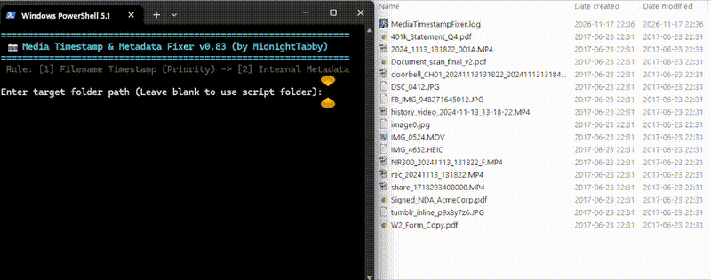
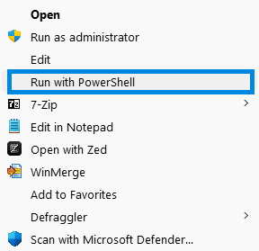

# 📸 Media Timestamp & Metadata Fixer

> Portable PowerShell script to standardize media file timestamps from filenames, XML sidecars, or metadata—with video duration offset support.

## 🔒 Zero-Byte Modification Guarantee
This tool only adjusts the file system timestamps (NTFS Creation & Modification times) to restore chronological order. Your original file binaries remain 100% untouched—exact hashes and internal metadata are completely preserved.


## 🚀 Why this exists (For Gen-Z, students, & digital packrats)
If you've ever moved files across multiple phones, cloud syncs, and old hard drives, you know the pain: your precious memories (including those "historical archives" from middle school) are scattered in a chaotic timewarp. 

This tool brings **order and Aesthetic peacekeeping** back to your camera rolls, dashcam footage, security cams, and random PDFs without requiring heavy runtimes or Python environments.


## 🛠️ Supported Naming Schemas (The Global Regex Vault)
MidnightTabby didn't sleep so your files could stay messy. We support:
- **Windows & Android Screenshots** (Snipping Tool & mobile variants)
- **Dashcams & Security Cameras** (BlackVue, Thinkware, Viofo, 70mai, Reolink)
- **Legacy Feature Phones** (SHARP, Panasonic, Nokia, Motorola, Samsung from the mid-2000s)
- **US English Month & Numeric Formats** (`NOV15-2027...`, `MM-DD-YYYY`)
- **Standard EXIF & QuickTime Metadata / PDFs (iTextSharp)**

<p align="center">
  
</p>

## 📊 Transparent Audit Logs (TSV / CSV Ready)
Every run automatically generates a detailed, tab-separated execution log (`MediaTimestampFixer.log`). You can easily inspect which source (`Filename`, `Internal Metadata`, or `PDF Metadata`) was used to restore each file, or import the log directly into Excel/spreadsheets for verification.

**Sample Log Output:**

| Timestamp | Status | FilePath | Source | Created | Modified |
| :--- | :--- | :--- | :--- | :--- | :--- |
|2026-11-18 20:14:26 | UPDATED | `D:\Recovered_Archive\2019_0204_052657_001A.MP4` | Filename + Duration | 2019-02-04 05:26:57 | 2019-02-04 05:27:57 |
|2026-11-18 20:14:26 | UPDATED | `D:\Recovered_Archive\401k_Statement_Q4.pdf` | PDF Metadata | 2008-01-21 12:53:07 | 2008-08-26 19:31:39 |
|2026-11-18 20:14:26 | UPDATED | `D:\Recovered_Archive\Document_scan_final_v2.pdf` | PDF Metadata | 2017-06-15 10:27:22 | 2017-06-15 10:27:22 |
|2026-11-18 20:14:26 | UPDATED | `D:\Recovered_Archive\doorbell_CH01_20240730120035_20240730122747_952700062CS5675J_0..MP4` | Filename | 2024-07-30 12:00:35 | 2024-07-30 12:27:47 |
|2026-11-18 20:14:26 | UPDATED | `D:\Recovered_Archive\DSC_0412.JPG` | Internal Metadata (ExifTool) | 2005-07-17 15:59:55 | 2005-07-17 15:59:55 |
|2026-11-18 20:14:26 | UPDATED | `D:\Recovered_Archive\FB_IMG_948271645012.JPG` | Internal Metadata (ExifTool) | 2021-04-03 10:03:35 | 2021-04-03 10:03:35 |
|2026-11-18 20:14:26 | UPDATED | `D:\Recovered_Archive\history_video_2015-07-05_17-21-31.MP4` | Filename + Duration | 2015-07-05 17:21:31 | 2015-07-05 17:22:16 |
|2026-11-18 20:14:26 | UPDATED | `D:\Recovered_Archive\image0.jpg` | Internal Metadata (ExifTool) | 2015-06-06 07:27:00 | 2015-06-06 07:27:00 |
|2026-11-18 20:14:26 | UPDATED | `D:\Recovered_Archive\IMG_0524.MOV` | Internal Metadata (ExifTool) | 2023-11-02 09:49:09 | 2023-11-02 09:49:11 |
|2026-11-18 20:14:26 | UPDATED | `D:\Recovered_Archive\IMG_4652.HEIC` | Internal Metadata (ExifTool) | 2026-07-04 20:52:16 | 2026-07-04 20:52:16 |
|2026-11-18 20:14:26 | UPDATED | `D:\Recovered_Archive\NR300_20120818_150507_F.MP4` | Filename + Duration | 2012-08-18 15:05:07 | 2012-08-18 15:06:07 |
|2026-11-18 20:14:26 | UPDATED | `D:\Recovered_Archive\rec_20211710_175027.MP4` | Internal Metadata (ExifTool) + Duration | 2024-05-27 04:03:32 | 2024-05-27 04:04:41 |
|2026-11-18 20:14:26 | UPDATED | `D:\Recovered_Archive\share_1718293400000.MP4` | Internal Metadata (ExifTool) + Duration | 2024-02-06 22:42:44 | 2024-02-06 22:43:10 |
|2026-11-18 20:14:26 | UPDATED | `D:\Recovered_Archive\Signed_NDA_AcmeCorp.pdf` | Internal Metadata (ExifTool) | 2011-05-13 11:50:42 | 2011-05-13 11:50:42 |
|2026-11-18 20:14:26 | UPDATED | `D:\Recovered_Archive\tumblr_inline_p9x8y7z6.JPG` | Internal Metadata (ExifTool) | 2000-07-02 13:37:24 | 2000-07-02 13:37:24 |
|2026-11-18 20:14:26 | UPDATED | `D:\Recovered_Archive\W2_Form_Copy.pdf` | PDF Metadata | 2018-02-02 10:54:58 | 2018-02-02 10:55:07 |

## ☕ Credits & Acknowledgments
- **Phil Harvey**: Legend who created ExifTool. Without him, we'd be guessing dates like it's 1999.
- **iText Group & Community**: Creators of iTextSharp, making robust PDF metadata and structure manipulation possible in a lightweight environment.
- **AI Collaborator (Gemini)**: Who drank way too much iced coffee to translate a Japanese developer's hyper-fixation on 20-year-old mobile regexes into clean PowerShell, proving that AI and human stubbornness are a **match made in heaven**.

---

## ⚡ Quick Start & Usage (How to Restore Order)

No complex installation or Python environments required. Just drop and run.

### 1. Prerequisites
- **Windows 10 / 11** (PowerShell 7 (Recommended) / Windows PowerShell 5.1+)
- **`exiftool.exe`**: Download the Windows Executable from [Phil Harvey's official site](https://exiftool.org/),
<blockquote><table class="dl lg"><tbody><tr><td rowspan="2"><b>Windows</b></td>
<td><b>32-bit: exiftool-13.64_32.zip (11.4 MB)</b></td></tr>
<tr><td><b>64-bit: exiftool-13.64_64.zip (11.2 MB)</b></td></tr>
</tbody></table></blockquote>

- rename `exiftool(-k).exe` to `exiftool.exe`, and place it in the **same folder** as this script (or add it to your System PATH).
- `itextsharp.dll`: Placed alongside the script for handling PDF metadata extraction.

### 2. Folder Structure
Keep it portable—put everything in one folder:
```text
📁 Chaos_Archive/
 ├── 📜 MediaTimestampFixer_v0.80.ps1
 ├── ⚙️ itextsharp.dll
 ├── ⚙️ exiftool.exe
 └── 📁 exiftool_files
```

### 3. Run the Script
1. Right-click `MediaTimestampFixer_v0.80.ps1` and select **"Run with PowerShell"** (or open PowerShell in the folder and run `.\MediaTimestampFixer_v0.80.ps1`).
2. If prompted about Execution Policy, run the following command in PowerShell first:
   ```powershell
   Set-ExecutionPolicy -Scope Process -ExecutionPolicy Bypass
   ```
3. Follow the on-screen prompt to specify your target folder (e.g., `D:\Photos\Chaos_Archive`) and let the hybrid engine align your timestamps.
4. Review the generated `MediaTimestampFixer.log` for a complete record of changes, and clean up the portable files/folders once the operation is complete.

### 💡 Pro Tip (Safety First)
**Always test on a small backup folder first before unleashing it on your entire 10-year camera roll!**

### 💡 Why Filename Priority over Internal Metadata?
You might wonder: *"Why parse filenames first instead of relying directly on internal EXIF or video metadata?"*

Here is the dirty secret of digital archiving: **File system metadata and internal timestamps lie, but a well-formulated filename rarely does.**
1. **The Delayed-Write / Copy Trap:** When moving files across different file systems (like FAT32, exFAT, NTFS, or cloud sync storages), internal file creation/modification dates (`CreationTime` / `LastWriteTime`) are frequently wiped, overwritten, or skewed to the exact timestamp of the file transfer. 
2. **Untrustworthy Device Clocks:** Many dashcams, security cameras, and legacy feature phones have dead internal batteries or lack NTP sync, causing their internal metadata (`CreateDate`) to default to absurd dates like 1970 or 2000. 
3. **The Lifeline:** Device firmware that explicitly stamps recording dates directly into the filename (e.g., `20261107_171352.mp4`) acts as an immutable, human-readable anchor. By prioritizing the filename regex first, we rescue the true temporal origin before falling back to internal metadata as a secondary safety net.

# Changelog

All notable changes to **MediaTimestampFixer** will be documented in this file.

For detailed language-specific release notes, please check:
- [English Documentation](./docs/en/CHANGELOG.md)
- [日本語ドキュメント](./docs/ja/CHANGELOG.md)

---

## [v0.86] - 2026-11-18 (Pre-release)
### Added
- **Hybrid Video Duration Offset**: Automatically queries ExifTool for exact numeric duration (`-n`) and appends it to calculate the correct `LastWriteTime` (end time) when only start timestamps are available from filenames or XML sidecars.
- **XML Sidecar Priority 2 Support**: Added 1-to-1 automatic matching for `.xml` sidecar files (Sony XDCAM, GoPro, CCTV/dashcams).
- **Enhanced TSV Audit Logging**: Improved tracking with precise source tags (e.g., `Filename + Duration`, `XML Sidecar`).

---

# 💡 Quick Tips: Fast Pre-Scan Recon (`ls` Style, No Heavy Tools Needed)

Before running deep media scans, heavy metadata/audio checks, or full hash comparisons across massive folders, use these three lightweight PowerShell snippets. They evolve the classic DOS/PowerShell `>` pipe/redirect workflow into clean, tab-separated (`TSV`) files with timestamps—zero extra installs, zero edits to your original files.

<p align="right">
  
</p>

> **📌 How to Run Any Snippet Below (No Terminal Needed)**
> 1. **Copy** the PowerShell code block below.
> 2. Save it in your target folder as a `.ps1` file (e.g., `scan_files.ps1`) encoded in **UTF-8**.
> 3. In Windows File Explorer, **right-click** the `.ps1` file and select **Run with PowerShell** (see image above).
> 4. Check the generated `*.tsv` report right next to your script—your original files are never modified.

## 1. Fast Recursive File & Size Inventory (`filelist_*.tsv`)

Want a quick list of **every file, size in MB, and last modified date** across a folder (including subfolders)? Press **Enter** to scan your current folder—or paste any folder path you want to check:

```powershell
# Prompt for target folder (press Enter to use the current folder)
$TargetDir = Read-Host "Target folder path (Press Enter for current folder)"
if ([string]::IsNullOrWhiteSpace($TargetDir)) {
    $TargetDir = (Get-Location).Path
}
$TargetDir = $TargetDir.Trim('"', "'", ' ')

# Save a timestamped TSV inside the scanned folder
$Stamp = Get-Date -Format "yyyyMMdd_HHmmss"
$OutFile = Join-Path $TargetDir "filelist_$Stamp.tsv"
$StartTime = Get-Date

Get-ChildItem -Path $TargetDir -Recurse -File -ErrorAction SilentlyContinue |
    Select-Object FullName,
        @{Name = "Size_MB"; Expression = { [math]::Round($_.Length / 1MB, 2) }},
        LastWriteTime |
    Export-Csv -Path $OutFile -Delimiter "`t" -Encoding UTF8

$Elapsed = (Get-Date) - $StartTime
Add-Content -Path $OutFile -Value "`nElapsed: $($Elapsed.ToString('hh\:mm\:ss'))" -Encoding UTF8

Write-Host "Saved to: $OutFile"
```

- **Zero path editing needed:** Works right out of the box on any drive, USB/SSD, or folder.
- **Tab-separated (`TSV`):** Commas in filenames won't break your columns, and each run creates a timestamped file so you don't accidentally overwrite earlier snapshots.
- **Elapsed time at the bottom:** Appends total scan duration so you know how long big folders take.

## 2. Extension & Size Breakdown (`ext_summary_*.tsv`)

Want to see what file types are actually eating up your drive or folder before deciding what to keep, convert, or clean up? Run this in your target folder:

```powershell
$TargetDir = (Get-Location).Path
$Stamp     = Get-Date -Format "yyyyMMdd_HHmmss"
$OutFile   = Join-Path $TargetDir "ext_summary_$Stamp.tsv"

Get-ChildItem -LiteralPath $TargetDir -Recurse -File -ErrorAction SilentlyContinue |
    Group-Object Extension |
    Select-Object @{Name = "Extension"; Expression = { if ($_.Name) { $_.Name.ToLower() } else { "(no_ext)" } }},
        @{Name = "Count"; Expression = { $_.Count }},
        @{Name = "Total_MB"; Expression = { [math]::Round((($_.Group | Measure-Object Length -Sum).Sum / 1MB), 2) }} |
    Sort-Object Total_MB -Descending |
    Export-Csv -Path $OutFile -Delimiter "`t" -Encoding UTF8

Write-Host "Saved -> $OutFile"
```

- **Fast terrain check:** Shows file counts and total MB per extension so heavy formats jump right out.
- **Spreadsheet-friendly:** Tab-separated (`TSV`) output stays clean when sorting or filtering.

## 3. Quick Duplicate Candidates (`dup_candidates_*.tsv`)

Before burning time calculating hashes across huge archives, spot obvious same-name + same-byte-size clones across folders in seconds:

```powershell
$TargetDir = (Get-Location).Path
$Stamp     = Get-Date -Format "yyyyMMdd_HHmmss"
$OutFile   = Join-Path $TargetDir "dup_candidates_$Stamp.tsv"

Get-ChildItem -LiteralPath $TargetDir -Recurse -File -ErrorAction SilentlyContinue |
    Group-Object Length, Name |
    Where-Object { $_.Count -gt 1 } |
    ForEach-Object {
        $_.Group | Select-Object @{Name = "GroupCount"; Expression = { $_.Count }},
            @{Name = "Size_MB"; Expression = { [math]::Round($_.Length / 1MB, 2) }},
            Name, FullName, LastWriteTime
    } |
    Export-Csv -Path $OutFile -Delimiter "`t" -Encoding UTF8

Write-Host "Saved -> $OutFile"
```

- **Fast triage, not final verdict:** Matches identical file **size + name** for quick leads—renamed copies or coincidental same-name/same-size files can still appear, so double-check before deleting anything.
